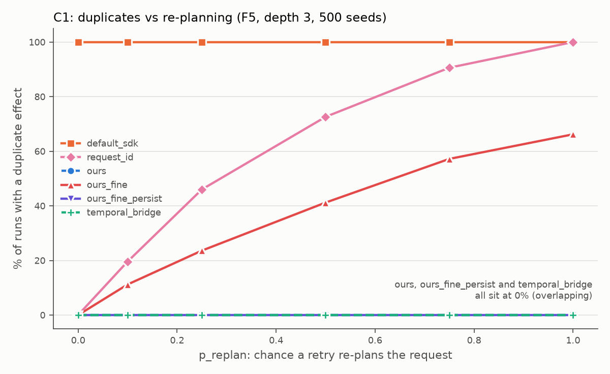
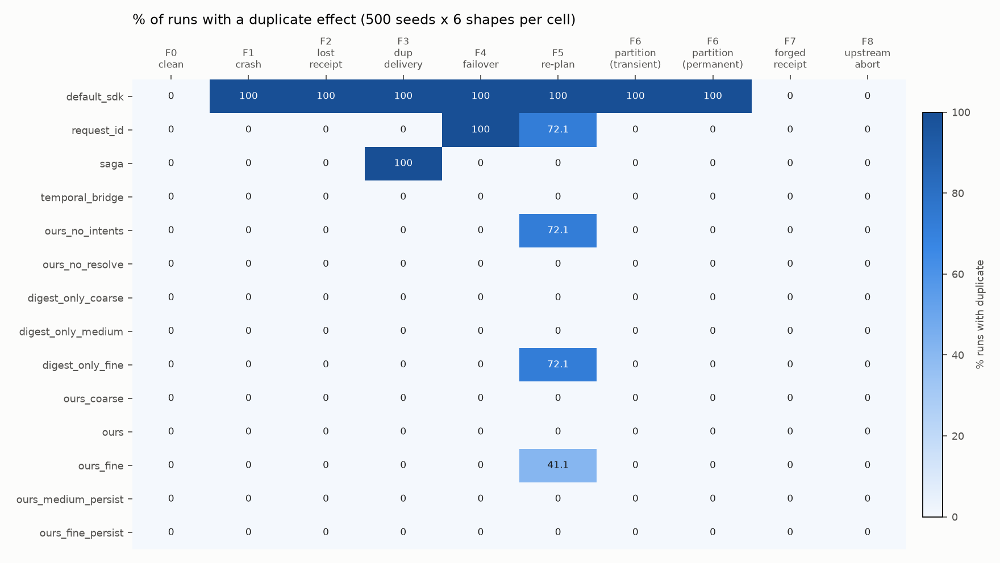
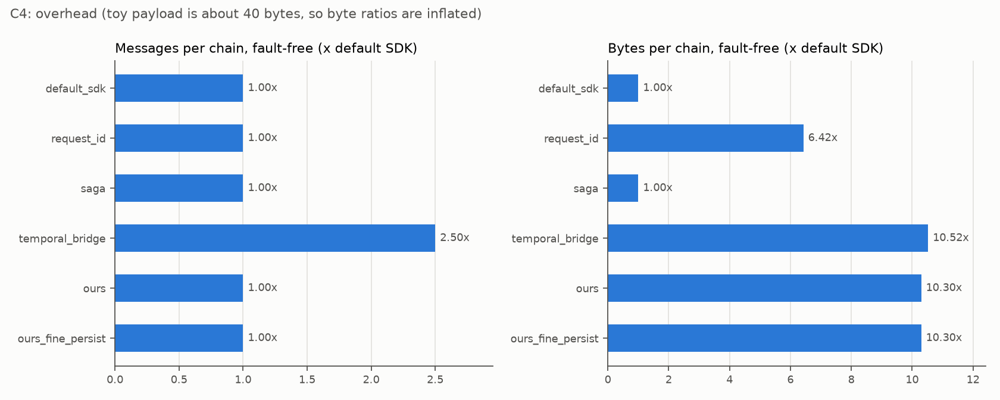
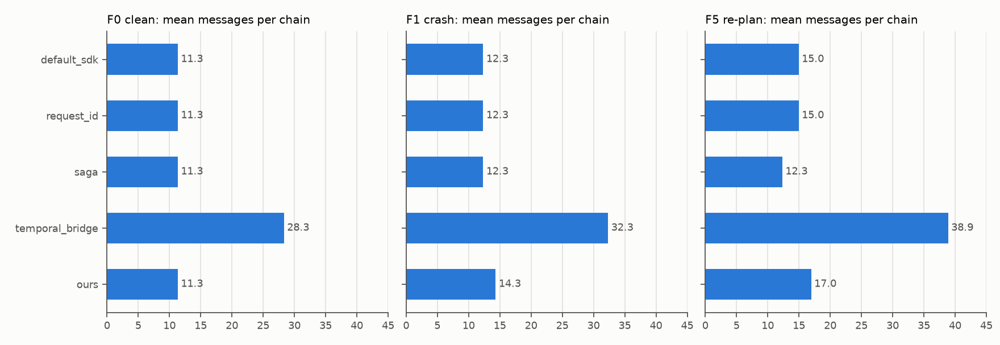
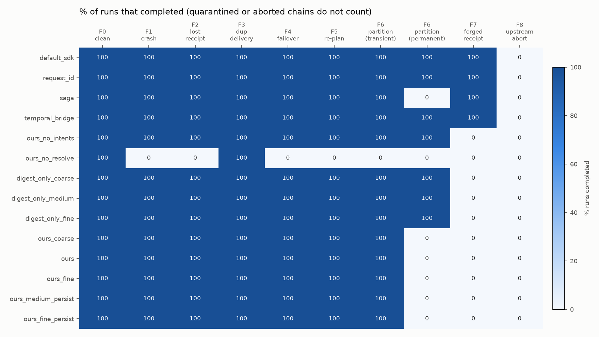
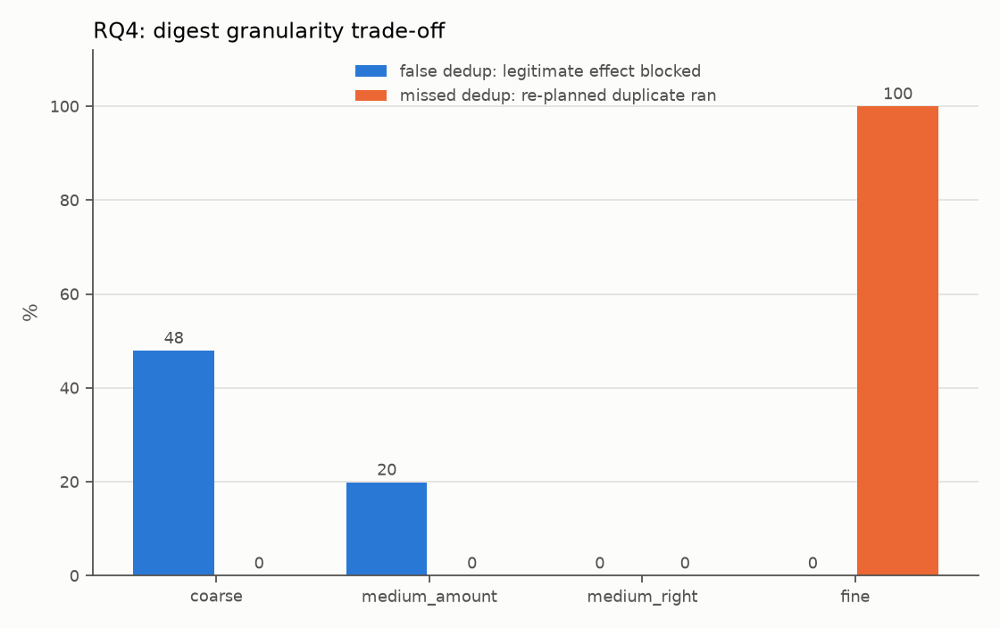

# Summary of results

All numbers come from `results/*.csv`, produced by `python -m bench.run` (500 seeds per cell,
seeds 0..499, depths 2/3/5, fan-out 1/3, pooled) and tabulated by `python -m bench.metrics` into
`results/tables.md`. Figures are in `results/figs/`. Provenance is in `results/MANIFEST.json`.
This is a simulation: a synchronous in-process engine running the real recovery library over a
faulty simulated network, one fault per run. It is not a deployment measurement.

## Claims

**C1. Request-ID dedup produces duplicates that grow with `p_replan`: SUPPORTED.**
On F5 (depth 3) request-ID dedup goes 0% / 19.6% / 46.0% / 72.6% / 90.6% / 100% of runs with a
duplicate at p_replan 0 / 0.1 / 0.25 / 0.5 / 0.75 / 1.0 (`c1_replan_sweep.png`). It also fails
every run of F4 (replica failover) regardless of re-planning. The default SDK duplicates on every
retry scenario (F1 to F6).

**C2. Ours has zero duplicate and zero lost effects on F1 to F6: SUPPORTED, with three conditions.**
- With coarse or medium digests: 0 duplicates and 0 lost effects on F1 to F6 in every cell.
- With a fine digest and no plan persistence, C2 FAILS on F5: `ours_fine` duplicates in 41.1% of
  runs, because re-delegation after a resume is a replay that may re-plan (D28). Persisting the
  planned downstream request (D29) brings it to 0% (`ours_fine_persist`). D29 is an addition
  beyond the guide, found by this evaluation.
- Under a permanent resolve partition (F6 permanent) there are 0 duplicates and 0 lost effects
  because every run is quarantined (100%) and none completes. Safety holds, availability does not.

**C3. Ours matches the Temporal upper bound on correctness without a shared control plane:
PARTIALLY SUPPORTED.**
On F1 to F6 transient, both have 0 duplicates, 0 lost, and 100% completion. They differ on:
- F6 permanent: the Temporal stand-in completes 100% (a central history needs no resolve), ours
  quarantines 100%.
- F7 forged receipt: ours detects 100% and quarantines; the Temporal stand-in accepts 100%.
  The stand-in does not verify signatures, so this is a design difference, not a flaw in Temporal.
- Cost: the stand-in sends 2.5x the messages fault-free.
The Temporal bridge is an in-process stand-in, not a Temporal server (D24).

**C4. Overhead stays under a stated bound: NOT EVALUATED AGAINST A BOUND; numbers reported.**
No bound was fixed before running, so none is claimed.
- Fault-free messages: 11.3 per chain for ours, identical to the default SDK (0 extra messages).
- Under faults ours sends more messages than the default SDK: F1 median 14 vs 12, F5 16 vs 14
  (resolveIntent round trips).
- Bytes: ours is 10.3x the default SDK, about 3.8 KB of recovery metadata per chain
  (`c4_overhead.png`). This ratio is inflated because the toy request payload is tiny (about
  40 bytes); it would shrink with real payloads, but that was not measured.
- Persisted plans store about 685 extra bytes per chain.
- Latency is not measured. Messages per run (p50/p95) are used as a proxy (D30).

## Research questions

- **RQ1** (duplicates and lost effects vs baselines): `duplicates_by_scenario.png`, tables in
  `tables.md`. Default SDK and request-ID dedup duplicate; Saga duplicates on F3 (hops do not
  dedup) and leaves a residual effect under a permanent partition; ours and the Temporal stand-in
  do not duplicate.
- **RQ2** (what resolveIntent buys): `ours_no_resolve` never duplicates but quarantines every
  in-doubt call (0% completion on F1, F2, F4, F5, F6). `resolveIntent` is what restores completion.

- **RQ3** (non-deterministic re-execution): the C1 sweep and the fine-digest result above.
- **RQ4** (digest granularity), `rq4_granularity.png`: coarse 48.0% false dedup / 0% missed;
  medium on amount only 19.9% / 0%; medium on the workload's true identity fields 0% / 0%; fine
  0% / 100%. The "right" medium policy matches the workload by construction (D27), so this shows
  the trade-off shape only.

## Also observed

- F8 (upstream abort): ours, Saga, and the Temporal stand-in leave 0% residual effects; default
  SDK, request-ID dedup, and the no-intents ablation leave 100%.
- Forged receipts (F7): 100% accepted by request-ID dedup and the Temporal stand-in, 0% by every
  signature-verifying system (default SDK and Saga have no receipts to forge).

## Limits

- Synchronous engine: no concurrency, no real timing. One fault per run, fired once.
- Failures are simulated; the toy agent's re-planning is a model, not a real LLM (real-LLM mode
  not implemented).
- Temporal and Saga are in-process stand-ins; "upper bound" labels apply.
- Honest signers only; forged receipts are detected, not tolerated (non-goal).
- The crash-enabled TLC run did not finish; safety and liveness were checked only without
  crashes (`formal/results.md`).
- Persisted plans do not help if the delegator crashes before saving the plan.
